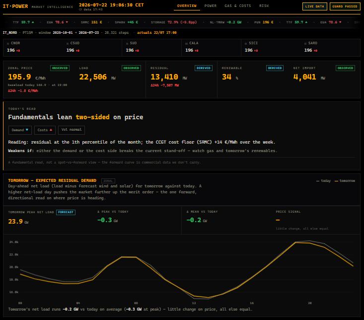
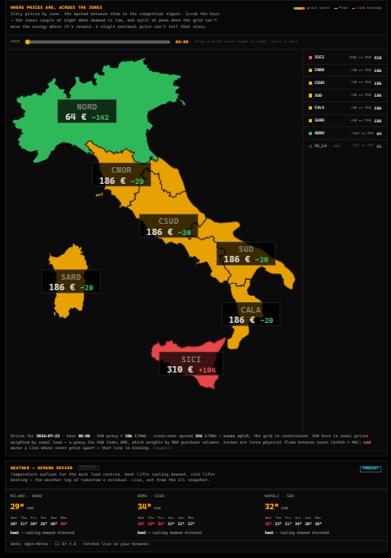
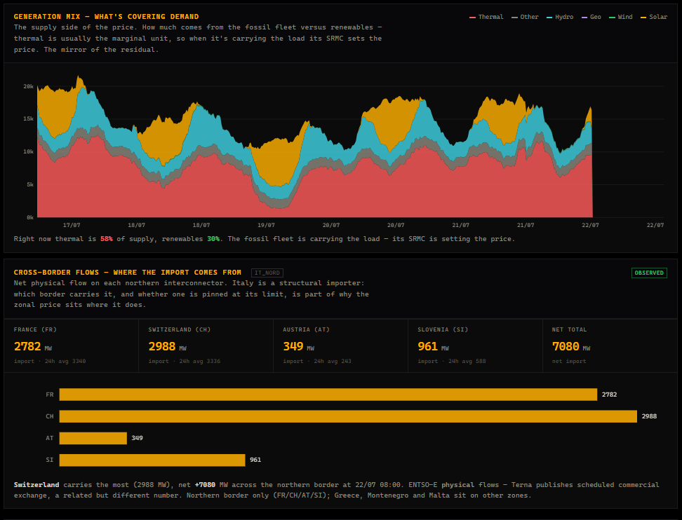
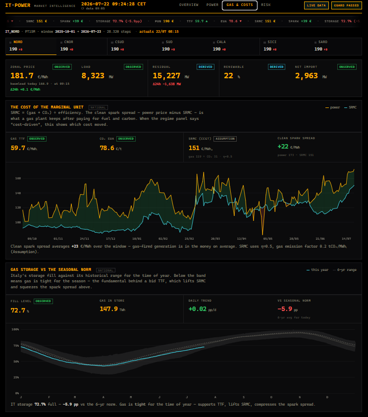
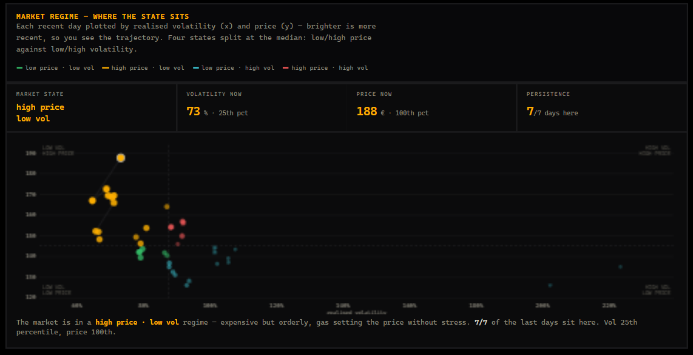

# IT·POWER — Italian power & gas market intelligence

A market-intelligence terminal for the Italian electricity market, built entirely on free
public data. It answers three questions: **why is the price where it is**, **where is it
heading tomorrow**, and **how much risk is in it** — across all seven bidding zones.

No database, no server, no build step: a re-runnable ETL writes plain JSON, and a single HTML
file reads it.



The zonal map is the centrepiece: seven bidding zones, an hour slider, and inter-zonal flow
arrows. Below, an hour where the North clears at 64 €/MWh while Sicily is at 310 — the island
decoupled, its link binding.



---

## Data provenance

Every published column carries **what kind of number it is**:

| badge | meaning | example |
|---|---|---|
| **Observed** | measured / cleared, taken as-is | zonal price, load |
| **Derived** | an exact function of observed inputs | residual demand, renewable share |
| **Proxy** | a stand-in, not the true quantity | PUN (unweighted mean of zonal prices) |
| **Assumption** | a chosen parameter, declared | CCGT efficiency η = 0.50 |
| **Forecast** | a model output, not an observation | tomorrow's net load |

There is no **Estimated** badge: no published quantity is reconstructed. Quantities that are
not observable from free data are listed under [Known gaps](#known-gaps) rather than
approximated — a constraint that drove the project's main methodological decision (see
[Methodology](#methodology)).

## Quick start

```bash
cp .env.example .env          # ENTSOE_TOKEN and AGSI_KEY — both free, both git-ignored
                              # TERNA_API_KEY/SECRET optional: adds the map's flow arrows
                              # TERNA_API_KEY/SECRET are optional (adds the map's flow arrows)
pip install -r requirements.txt

python -m etl.build           # 7 zones + snapshot + fuels + storage + forecasts + flows
python -m http.server         # from the repo root
# open http://localhost:8000/spa/
```

`pytest tests/ -q` → 22 guardrail tests.

> **Timing.** ENTSO-E publishes tomorrow's day-ahead forecast around midday. A morning run
> therefore shows only today in the *Tomorrow* panel; run in the afternoon for the forward
> signal.

## What's inside

| tab | answers |
|---|---|
| **Overview** | the market read (a fundamental bias with the conditions that would invalidate it), tomorrow's expected residual demand, the zonal map with an hour slider — zones couple at night and split at peak, with inter-zonal flow arrows marking which link is binding — and weather as demand context |
| **Power** | recent trend and percentile, generation mix (the supply side of the price), cross-border flows by interconnector |
| **Gas & costs** | TTF, EUA, the marginal CCGT's SRMC and the clean spark spread; gas storage against its 6-year seasonal band |
| **Risk** | realised volatility (peak vs off-peak, gas→power β) and a market-regime phase scatter: calm / firm / choppy / stressed |

**Power** — the supply side: what is covering demand, and which border carries the import.



**Gas & costs** — the cost floor under the power price, and the gas fundamental under that.



**Risk** — where the market sits in volatility/price space, and how long it has been there.



A zone selector switches every zonal panel across the seven bidding zones. Panels that are
national (gas, storage) or NORD-scoped (border flows) say so on the header.

## Design decisions

- **Window from 2025-10-01 — one regime.** Avoids both 2025 structural breaks (PUN Index GME on
  01-01, MGP 15-min MTU on 10-01). A `single_frequency` guard refuses to mix granularities.
- **Residual demand from the supply side**: `R = dispatchable − pumping + net import`. The same
  economic quantity as `Load − must-run`, but built from observed columns only.
- **Two clocks, both stamped.** The day-ahead price is known for the whole day; actuals arrive
  late, and the newest slots are provisional because providers overwrite them. The KPIs read the
  price at the current hour and the actuals at the newest *settled* instant, and the UI stamps
  both, so the reference time of every figure on screen is explicit.
- **Publish guard.** A failed refresh (broken axis, coverage < 98%) leaves the live JSON
  untouched instead of shipping garbage. One failed zone never sinks the others.
- **Incremental cache.** First run downloads the window; later runs fetch only the tail plus a
  2-day overlap to absorb ENTSO-E's revisions, deduping to the latest.

## Known gaps

- **Distributed PV.** Material in size, but not identifiable from the energy-balance closure
  error using free data. Two estimators were built and both withdrawn (see Methodology). The
  unexplained residual is published as `closure_error` (|ε| ≈ 2.7 GW mean on IT_NORD) rather
  than attributed to solar. Cross-checked against Terna's national self-consumption series,
  roughly half of it is not solar at all: 2.6 GW is present at night (industrial CHP, biogas,
  small hydro below ENTSO-E's reporting thresholds).
- **PSV–TTF basis.** The true PSV is commercial (ICIS Heren); the free GME MGP-GAS is a
  different price with no clean API. The signal is small (~1-3 EUR/MWh) and the only free route
  requires scraping, so the basis is documented rather than implemented.
- **Forward curve.** EEX power forwards are paid data, so this is a *fundamental* read, not a
  spot-vs-forward view — and the market-read panel says exactly that.
- **Exact PUN.** Ours weights zonal prices by zonal load (Proxy). The real PUN Index GME
  weights by MGP purchase volumes, which exclude pumping and exports; GME publishes the index
  and the volumes, but through its website rather than an API. Load weighting removes most of
  the error an unweighted mean carries (2-3%, up to 4.5 EUR/MWh when an island decouples).

## Methodology

[`docs/nodi_A_B_metodologia.md`](docs/nodi_A_B_metodologia.md) is the reasoning, not a summary:
the boundary facts (ENTSO-E load is net, solar is gross), the 2025 regime breaks, and the full
record of the distributed-PV estimator — what it assumed, the data that falsified it, and why
it was withdrawn rather than tuned. Fitting it across all seven bidding zones returned
physically impossible shares (−124% to +333%) at comparable R², which indicates
misspecification rather than noise. The retired approaches are documented alongside the
current one.

## Stack

Python (pandas, pyarrow) · [ENTSO-E Transparency](https://transparency.entsoe.eu) via
`entsoe-py` · [GIE AGSI+](https://agsi.gie.eu) via `gie-py` · TTF/EUA via `yfinance` ·
[Open-Meteo](https://open-meteo.com) (client-side) · vanilla JS + canvas, no framework.

```
etl/          fetch → cache → transform → guard → JSON      (CLI: python -m etl.build)
              internal_flows.py is optional: without Terna keys the map just omits the arrows
spa/          the dashboard: one file, no build step (DESIGN.md — identity, and one reversal on the record)
tools/        settle_check.py — measure ENTSO-E's real revision horizon
docs/         methodology
tests/        22 tests: transform identities, cache, fuels, flows, forecast, leakage
```

## Acknowledgements

This project follows the approach of [gb-power-dashboard](https://github.com/lptva/gb-power-dashboard)
by [lptva](https://github.com/lptva), a market-intelligence terminal for the Great Britain power
market. Adopted from it:

- the architecture — a single-page static app with no build step, over a re-runnable ETL that
  writes plain JSON;
- the provenance discipline — every published figure badged observed / derived / proxy /
  assumption, and a *known limitations* section for what free data cannot support;
- the publish gate — a failed refresh leaves the live JSON untouched rather than shipping a
  broken panel;
- the incremental ETL: tail-only fetch with a revision overlap, atomic writes, cache-busting;
- per-panel error isolation, so one failing chart cannot blank a tab;
- pinning verified figures in tests;
- treating a non-interconnected zone as a labelled reference market rather than a counterparty.

The Italian market work is this project's own: the zonal structure and coupling analysis, the
supply-side residual and the withdrawal of the distributed-PV estimator (see Methodology), the
gas leg (TTF/EUA, marginal-CCGT SRMC, AGSI+ storage), the day-ahead outlook, and the
volatility and regime panels.

## Licence

MIT — see [LICENSE](LICENSE).
